# WhatToCook - serverless mobile + web

Independent port of WhatToCook to a serverless stack: an Android app (React Native +
Expo) and a static web app (React + Vite), both backed by Supabase. No servers to operate.

- Reference (read-only): `../WhatToCook-AI-Powered-Recipe-Generator`
- Live web preview: https://rezaxr14.github.io/WhatToCook_mobile_serverless/
- Build plan: `implementation_plan.md` (local-only, untracked)
- Supabase setup: `docs/SUPABASE.md`
- AI HTTP contract: `docs/api.md`
- Operations runbook: `docs/runbook.md`

## Demo

Both clients talk to the same Supabase project: auth, pantry, catalog, Storage
images and the AI Edge Functions. No provider key ever reaches the browser or
the app bundle.

### Web (serverless SPA/PWA)

The static build is hosted on GitHub Pages. Signing in as a guest starts an
anonymous session, stocks a demo pantry and enables the AI studio.

<table>
  <tr>
    <td width="50%">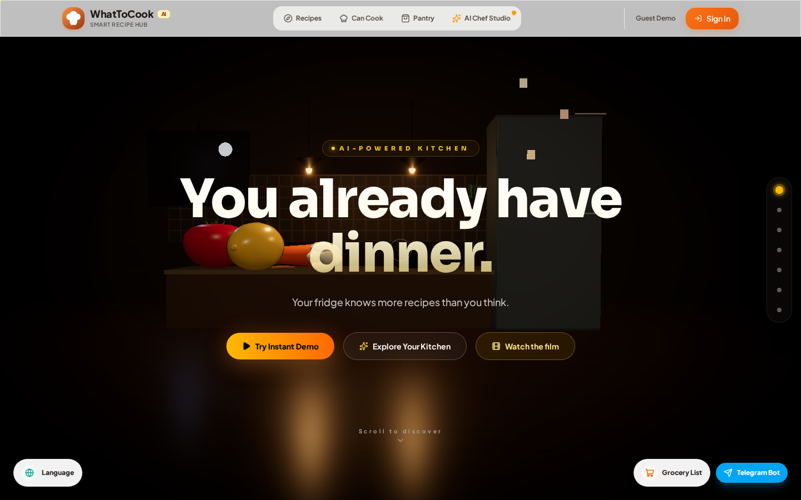</td>
    <td width="50%">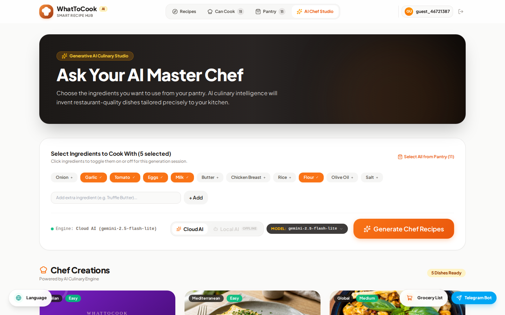</td>
  </tr>
  <tr>
    <td align="center"><em>Landing — installable PWA</em></td>
    <td align="center"><em>AI Chef — server-side AI generation</em></td>
  </tr>
  <tr>
    <td width="50%">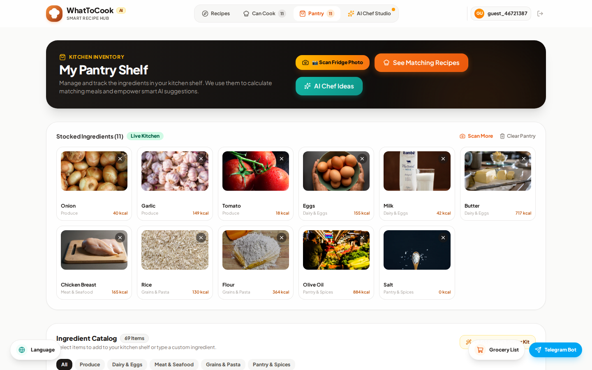</td>
    <td width="50%">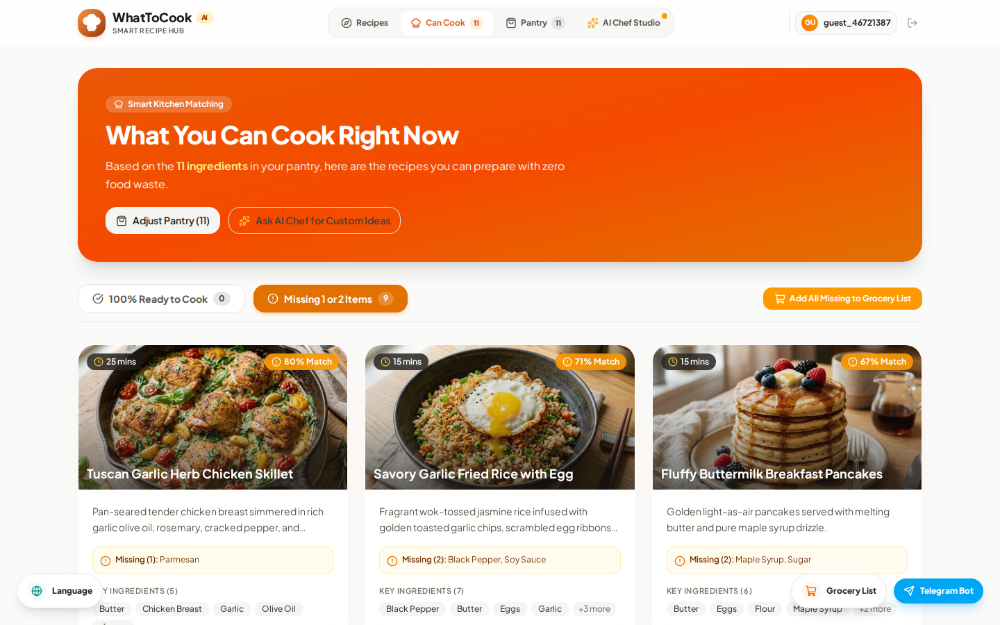</td>
  </tr>
  <tr>
    <td align="center"><em>Pantry inventory</em></td>
    <td align="center"><em>Pantry matching</em></td>
  </tr>
  <tr>
    <td width="50%">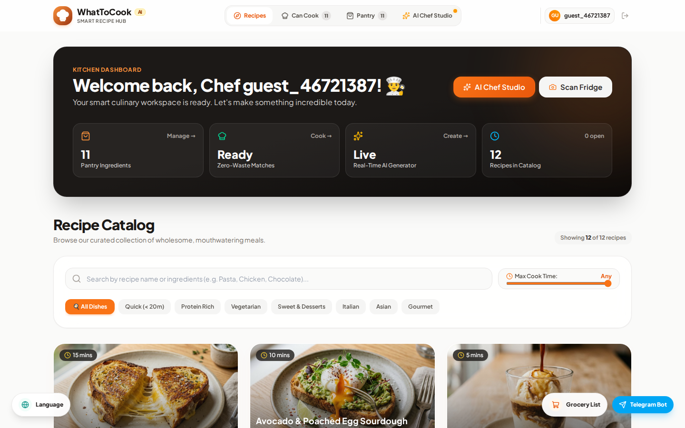</td>
    <td width="50%">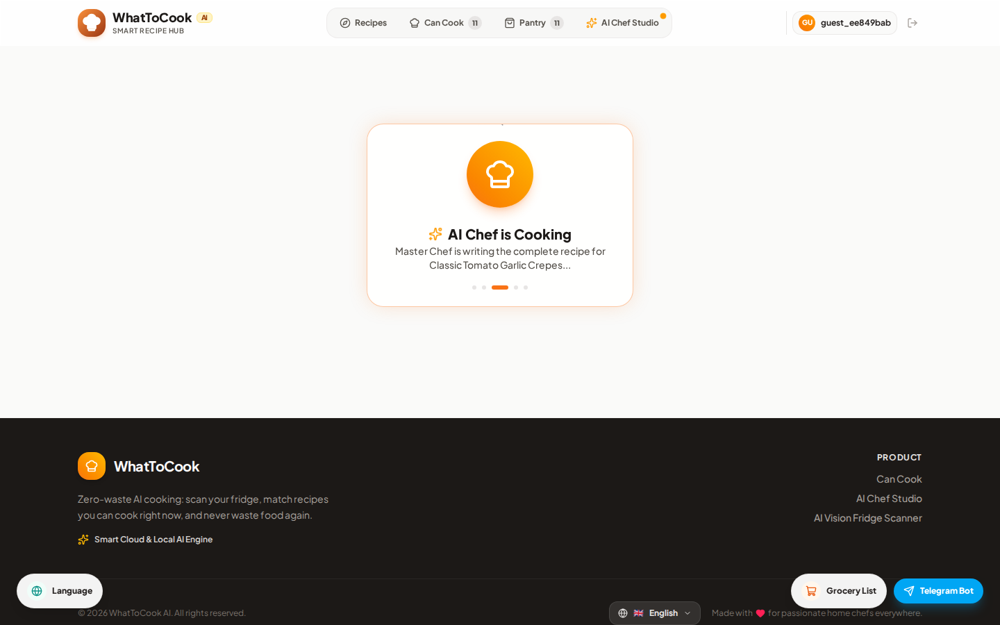</td>
  </tr>
  <tr>
    <td align="center"><em>Recipe catalog</em></td>
    <td align="center"><em>Generated recipe detail</em></td>
  </tr>
  <tr>
    <td width="50%">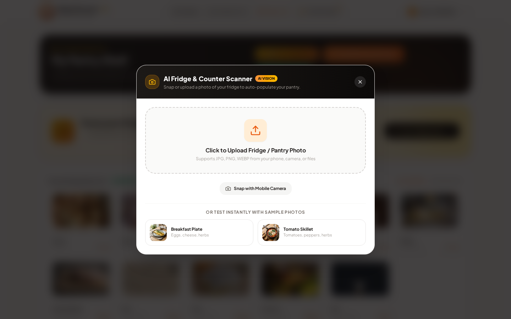</td>
    <td width="50%">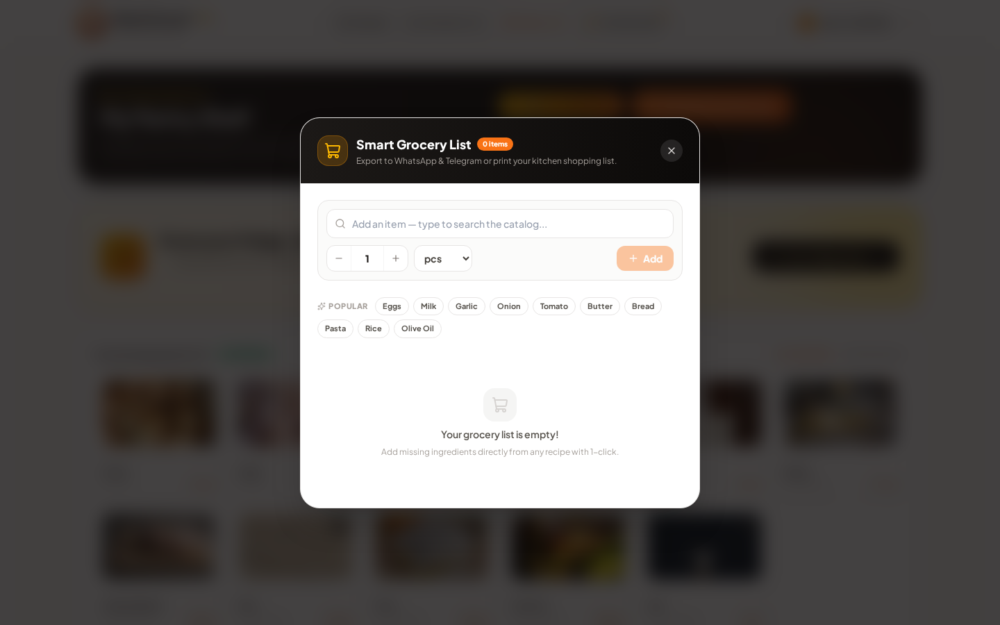</td>
  </tr>
  <tr>
    <td align="center"><em>AI Vision fridge scanner</em></td>
    <td align="center"><em>Grocery list with unit-aware entry</em></td>
  </tr>
</table>

### Android (Expo / React Native)

<table>
  <tr>
    <td>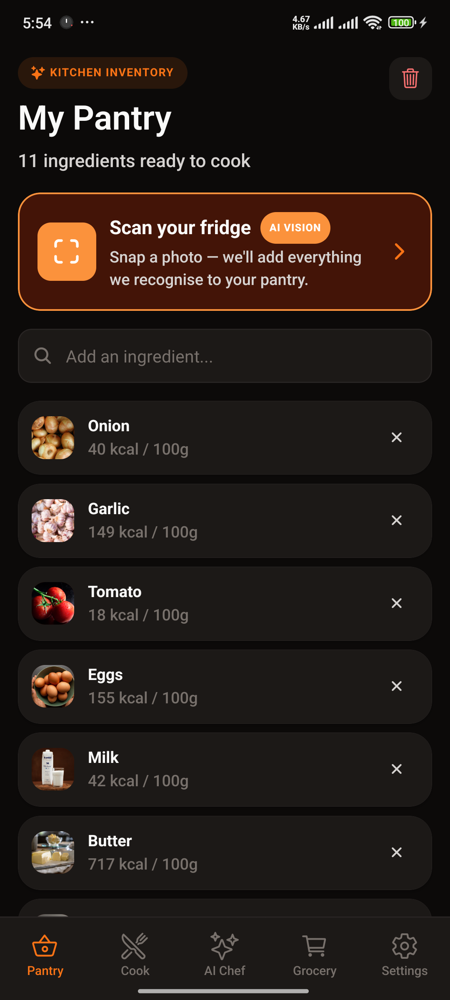</td>
    <td>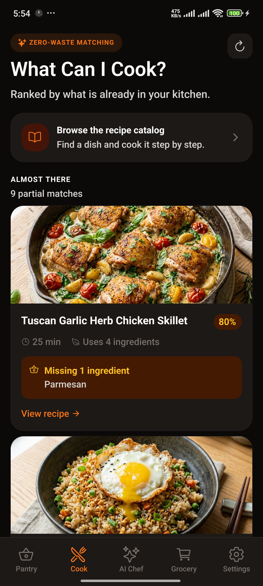</td>
    <td>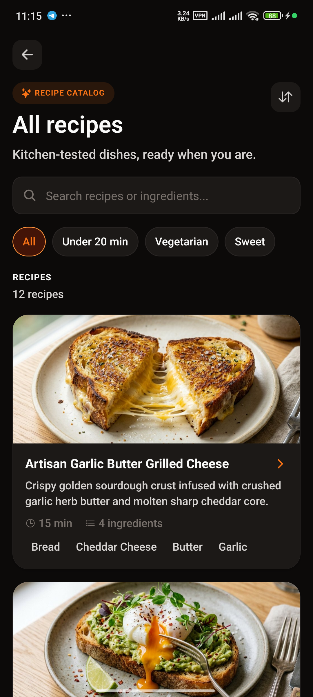</td>
  </tr>
  <tr>
    <td align="center"><em>Pantry</em></td>
    <td align="center"><em>Cook with what you have</em></td>
    <td align="center"><em>Recipe catalog</em></td>
  </tr>
  <tr>
    <td>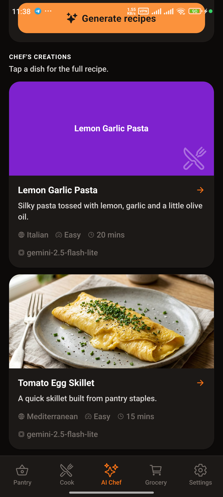</td>
    <td>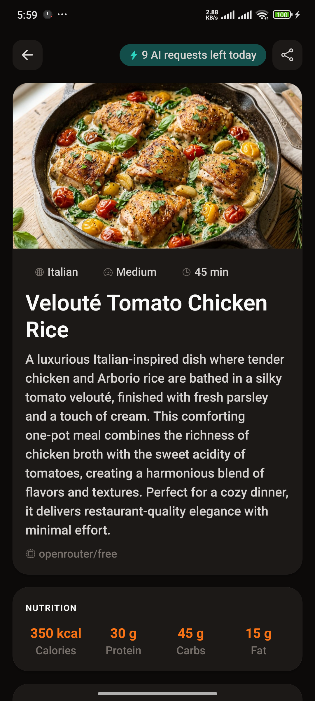</td>
    <td>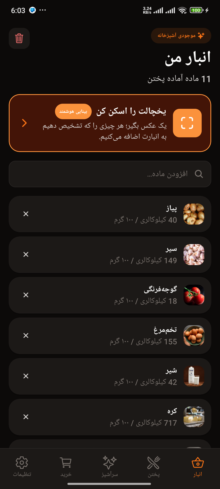</td>
  </tr>
  <tr>
    <td align="center"><em>AI Chef</em></td>
    <td align="center"><em>Generated recipe</em></td>
    <td align="center"><em>Persian / RTL</em></td>
  </tr>
</table>

### What the demo covers

- Guest sessions with a pre-stocked pantry, no account required.
- Pantry search, add/remove, calorie totals and camera/gallery ingredient scans.
- AI Vision scans keep unmatched detections: foods that are not catalogued yet are
  created through a validated `SECURITY DEFINER` RPC and added to the pantry in the
  same step, on both web and Android.
- Recipe catalog, pantry matching, serving scaling, substitutions and grocery export.
- Catalog-aware grocery entry with search-as-you-type suggestions, amount stepper
  and units, so the list is ready to shop from.
- AI Chef suggestions, full generated recipes, chef chat and a streaming status.
- Cached ingredient/dish photos served from Supabase Storage, with a local
  fallback when a photo is missing.
- Installable PWA: the install action sits beside Grocery and Telegram instead of
  covering them, and an offline pill appears when the connection drops.
- Five locales (en, tr, fa, ar, es) including right-to-left Persian and Arabic.

## Layout

```
apps/web            React + Vite static SPA/PWA
apps/mobile         Expo SDK 58 Android app (Expo Router, auth, i18n, pantry/cook/grocery, recipe catalog/detail, AI Chef, scanner)
packages/shared     types, shared translations, AI contracts, database types
supabase/           migrations, seed, tests, catalog images
docs/               PROGRESS, DECISIONS, porting notes, Supabase runbook
```

## Environment

- Root `.env.example` is the full environment contract. Copy it to `.env.local`
  for Supabase CLI/CI and server-side secrets. `.env.local` is gitignored.
- Web: copy `apps/web/.env.example` to `apps/web/.env.local`. Only the public
  `VITE_SUPABASE_URL`, `VITE_SUPABASE_ANON_KEY`, and `VITE_APP_ENV` values are
  needed.
- Mobile: copy `apps/mobile/.env.example` to `apps/mobile/.env.local`. Only
  `EXPO_PUBLIC_SUPABASE_URL` and `EXPO_PUBLIC_SUPABASE_ANON_KEY` are needed; the anon
  key is public by design.
- The GitHub Actions `staging` environment needs `SUPABASE_ACCESS_TOKEN`,
  `SUPABASE_PROJECT_ID`, and `SUPABASE_DB_PASSWORD`.
- Never put a service-role key or AI provider key in `VITE_*` or
  `EXPO_PUBLIC_*`; those values are public.

### Android toolchain (Linux / WSL2)

A local debug build works from the Linux home folder; nothing lives under `/mnt/c`.
Versions are pinned by the generated Gradle files, not by this table.

| Tool                   | Version                                          | Location                             |
| ---------------------- | ------------------------------------------------ | ------------------------------------ |
| Ubuntu / kernel        | 26.04 LTS / 6.6.114.1-microsoft-standard-WSL2    | -                                    |
| Node / pnpm            | 24.22.1 / 12.14.0                                | nvm                                  |
| JDK                    | OpenJDK 17.0.20.1                                | `/usr/lib/jvm/java-17-openjdk-amd64` |
| Android SDK            | cmdline-tools 16111833, Android CLI 1.0.16625370 | `~/Android/Sdk`                      |
| platform-tools / adb   | 37.0.1 (adb 1.0.41)                              | `~/Android/Sdk/platform-tools`       |
| Platforms              | android-36 (r02), android-37.0 (r02)             | `~/Android/Sdk/platforms`            |
| Build-tools            | 36.0.0, 37.0.0                                   | `~/Android/Sdk/build-tools`          |
| NDK / CMake            | 27.1.12297006 / 3.22.1                           | `~/Android/Sdk/{ndk,cmake}`          |
| Gradle (wrapper) / AGP | 9.4.1 / 9.2.1                                    | project                              |

`~/.bashrc` exports `JAVA_HOME`, `ANDROID_HOME`, `ANDROID_SDK_ROOT` and puts
`cmdline-tools/latest/bin` and `platform-tools` on `PATH`.

Build the debug APK:

```bash
cd apps/mobile && npx expo prebuild --platform android
cd android && ./gradlew :app:assembleDebug
# apps/mobile/android/app/build/outputs/apk/debug/app-debug.apk (all 4 ABIs)
```

Prefer not to install the Android SDK locally? `.github/workflows/android-device.yml`
builds a debug-signed release APK on every mobile change to `main` (and on manual
dispatch). Each build refreshes the rolling
[`android-device-latest` release](https://github.com/rezaxr14/WhatToCook_mobile_serverless/releases/tag/android-device-latest),
so you can download `WhatToCook-android-device.apk` directly on a phone. The same APK is
kept as the `whattocook-device-<sha>` Actions artifact for 14 days. Production/Play
signing stays in `android-release.yml` and still needs the release keystore secrets.

Install on a device that is visible to the Windows adb server (WSL2 NAT mode):

```bash
# Windows (PowerShell): adb kill-server; adb -a nodaemon server start
# Windows (admin, once): New-NetFirewallRule -DisplayName "WSL ADB 5037" `
#   -Direction Inbound -Protocol TCP -LocalPort 5037 -Action Allow
export ADB_SERVER_SOCKET=tcp:$(ip route show default | awk '{print $3}'):5037
adb devices
adb install -r apps/mobile/android/app/build/outputs/apk/debug/app-debug.apk
```

`adb reverse` targets the Windows adb server, not WSL, so Metro needs either a
Windows `netsh interface portproxy` relay to the WSL IP or
`networkingMode=mirrored` in `%UserProfile%\.wslconfig`.

Network workarounds in this environment (details in `docs/PROGRESS.md`):
`dl.google.com` returns 404, so SDK packages come from `redirector.gvt1.com` and
Maven artifacts from the Aliyun mirrors configured in
`~/.gradle/init.d/android-mirror.gradle`. Gradle distributions come from
`services.gradle.org` and are unaffected.

## Commands

```bash
pnpm install
pnpm -r typecheck
pnpm -r lint
pnpm -r test
pnpm --filter @whattocook/web build
pnpm dev:web

# mobile (Expo)
pnpm dev:mobile            # Metro / Expo Go
pnpm android               # expo run:android (native debug build + install, needs the SDK)
cd apps/mobile && npx expo export --platform android   # bundle smoke test

# local Supabase (Docker optional; see ADR-006)
pnpm supabase:start
pnpm supabase:reset
pnpm supabase:test
pnpm gen:types

# Edge Functions (local fake provider)
pnpm exec supabase functions serve --env-file supabase/functions/.env --no-verify-jwt
pnpm dlx deno check --config supabase/functions/deno.json supabase/functions/generate-recipe/index.ts
pnpm dlx deno lint --config supabase/functions/deno.json supabase/functions
pnpm dlx deno test --config supabase/functions/deno.json --allow-env --allow-net supabase/functions/tests

# staging types / deploy verification (requires .env.local credentials)
pnpm gen:types:remote
pnpm exec supabase link --project-ref <project-ref>
pnpm exec supabase db push --dry-run
```
